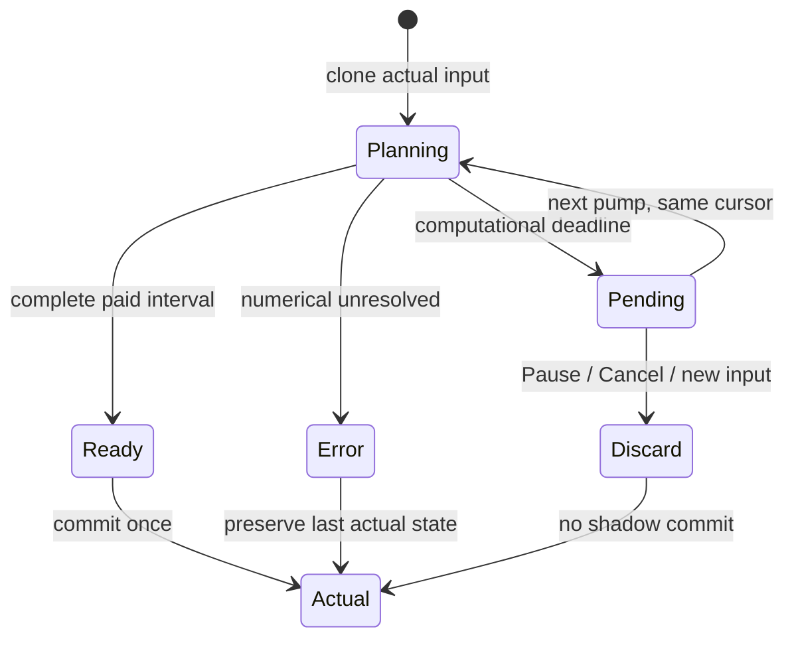

# Источник и воспроизведение

Developer: gpt-6.1-sol / high по metadata PM. Численный source **dae899b01fa195e9818cc7645cf676adb84768d8**,
Node24.22.0, каталог `ship-fitting-0.3.4`, seed424242. Каталог, материал/C,
тяга/расход, thermal gates, D40%, генераторные коэффициенты и powered-off dock
не менялись. Новая `ship-mission/2` меняет только команды и их численные границы.
Это измерения Developer до независимых QA/Review; U2 production/Pages NOT RUN.

Из корня checkout с Node24:

```sh
node --no-warnings --loader ./docs/research/2026-10-26-diesel-balance/loader.mjs docs/research/2026-10-27-ermak-flight-corrections/run.mjs /tmp/ermak-reproduction dae899b01fa195e9818cc7645cf676adb84768d8
node docs/research/2026-10-27-ermak-flight-corrections/verify.mjs /tmp/ermak-reproduction
```

Producer отвергает runtime bytes, отличающиеся от указанного source. Final
artifact/docs commit может быть позднее:155 source paths должны быть byte-equal.
22 полных receipts содержат exact spec/conditions SHA, seed, stock/energy/event
ledgers и digest full result. CSV — [results.csv](results.csv), индекс —
[receipts.json](receipts.json), pins/files — [manifest](manifest.json).
Большие raw result JSON пишутся в ignored `.overgate-runtime/pr53-raw`, не в Git.
Стенд не подменяет каталог в памяти. Только отдельно помеченные dt references
вызывают тот же physical job на0.5/0.25; это не изменение production dt1.

# Что изменилось в управлении

Legacy controller мог пропустить coast→brake из-за несовпадения tolerances,
а постоянная тормозная сила не учитывала будущую thermal/power/mass динамику.
New2 прогнозирует настоящий paid kernel, actual impulse и mean mass. Shadow
clock использует остаток до общей outer boundary, затем1s. Прогноз заканчивается
по stop/target-cross/current authority; observation H и CPU deadline не являются
физическим пределом. Event root требует x1e-3m/v1e-4m/s witness. Arrival/service
возникают только после реального движения; слишком поздний checkpoint не получает
обещания невозможной остановки. Без источника нет бесплатного impulse/service.



Job/memo не входят в State/RunSpec/checkpoint. Pending0steps не меняет stocks,
RNG, events, metrics или счётчики; Step intent живёт до одного actual tick.
Exact-state suffix memo ограничивает память, а не физическую длительность;
cold/evicted recomputation даёт тот же numerical result.

# Ермак: фактическая работа и тепло

Корабль/ангар300K, фон250K, плечо100km, cruise450m/s, cargo36SCU,
approach/service 10s, repeat и replenishmentON. None и passive3 различаются
реальным монтажом с честной массой/C. ActiveON/OFF — одинаковый установленный
состав, разница только enabled; это обычный Active, не pump-loop/TI.
Пассивные всегда открыты, enabledOFF не снимает их площадь.

| Состав | H, s | Final T / peak, K | First soft derate, s | Добыто / доставлено / на борту, SCU | Рейсы | Work, GJ | Дизель, kg |
|---|---:|---:|---:|---:|---:|---:|---:|
| none | 1200 | 414.120 / 416.400 | нет | 36.000 / 36.000 / 0.000 | 1 | 0.864000 | 131.836 |
| passive3 | 1200 | 375.993 / 386.573 | нет | 36.000 / 36.000 / 0.000 | 1 | 0.864000 | 134.739 |
| active2-on | 1200 | 410.710 / 412.630 | нет | 36.000 / 36.000 / 0.000 | 1 | 0.864000 | 135.320 |
| active2-off | 1200 | 410.710 / 412.630 | нет | 36.000 / 36.000 / 0.000 | 1 | 0.864000 | 135.320 |
| none | 3600 | 519.123 / 531.079 | 2325 | 112.501 / 108.000 / 4.501 | 3 | 2.700014 | 378.237 |
| passive3 | 3600 | 424.585 / 432.497 | нет | 136.167 / 108.000 / 28.167 | 3 | 3.268009 | 395.982 |
| active2-on | 3600 | 450.033 / 464.301 | нет | 136.104 / 108.000 / 28.104 | 3 | 3.266497 | 406.750 |
| active2-off | 3600 | 518.651 / 530.488 | 2385 | 113.887 / 108.000 / 5.887 | 3 | 2.733281 | 388.471 |
| none | 10800 | 515.239 / 531.882 | 2325 | 287.653 / 252.000 / 35.653 | 7 | 6.903680 | 869.772 |
| passive3 | 10800 | 427.212 / 437.787 | нет | 396.000 / 360.000 / 36.000 | 10 | 9.504000 | 1248.983 |
| active2-on | 10800 | 449.616 / 464.313 | нет | 396.000 / 360.000 / 36.000 | 10 | 9.504000 | 1295.129 |
| active2-off | 10800 | 515.289 / 531.915 | 2385 | 286.654 / 252.000 / 34.654 | 7 | 6.879685 | 890.292 |

Ни у одного нового mission row за10800 s нет thermalStopped engine/mining.
Это не универсальная/многосуточная устойчивость. First soft derate фиксируется
при actual working consumer вне его work band; firstStop в receipt — отдельный
installed engine/mining thermalStopped, а не число рейсов или конец H.
Конечные величины относятся строго к указанному H; completed/delivered/onboard
не подменяются числом начатых рейсов. Минимум inbound x — retained outer endpoints;
событие arrival отдельно подтверждает остановку до approach/service.

Phase budgets содержат интегралы net/host heat, generator bus, converter losses,
радиации, work и расхода топлива. Строки вида `inbound->service` явно содержат
пограничный outer interval. `generatorHostJ` — восстановленный из actual bus
host budget до EM split. `radiatorRejectedJ` — фактическое signed излучение всех
радиаторных поверхностей, включая fixed; body отдельно в общей radiationW.
`radiatorAuxJ` — **inferred electrical residual** delivered−consumer−hull,
не отдельный счётчик насоса. Из-за усреднения смешанных intervals он оставляет
малый остаток даже у none/OFF. Не читать его как прямое измерение auxOFF.
Топливо везде initial+stationReceived−final; phase расход проверяется отдельно.

На10800 s ActiveON отвергает больше тепла и сохраняет больше работы, чем OFF,
но whole-run ΔgeneratorHost включает различие работы и фаз. Это не постоянная
надбавка generator heat только от насоса. Изолированная net-physical полезность
Active уже квалифицирована E3 на том же неизменном kernel C2; новый flight fix
не переопределяет Active площадь/КПД/пределы. Численный thermal integral C·ΔT
сходится с суммой netHeatJ лучше0.001J во всех22 rows.

# Слабое питание и вычислительная стоимость

- `weak-full-leg`: arrival 1570.985434752s, service 1580.985434752s; observed endpoint 1581s, completed1/delivered30SCU; wall35.664s, max pump80.049ms.
- `weak-paid-braking-leg`: arrival 1058.879968209s, service 1068.879968209s; observed endpoint 1069s, completed1/delivered30SCU; wall1.388s, max pump55.075ms.

Один и тот же физический SputnikE со штатным weak D-generatorXS450kW,
charge0 и cargo30. Full leg начинается x500km/v−450m/s и включает coast/команды;
paid braking control начинается на расстоянии239615.7064384307m — диагностическом
rest witness C2, без новых ТТХ. Его остановка1058.88 s не обрезается256/H1.
Observed endpoint после обслуживания округлён к outer boundary: его T/stocks
не выдаются за мгновенный arrival state. Первые Pending порции не тратят stocks.

Предыдущий workingtree whole-leg wall75.51 s — performance baseline до exact
suffix reuse; отдельный standalone stopping forecast1058.88 s — физическое время,
не wall и не полный рейс. Операционные slices1/7/64/unlimited и H1/1200/3600/10800
проверены по общим state/metrics/events/channels/signatures/buckets. Pure planning
не вводит hidden cruise cap/source-readiness отказа. Слабые нестандартные сборки
могут требовать длительного cooperative расчёта; не обещаем одинаковый wall-time.

Реальный Worker desktop1440/mobile390 прошёл Pause/Step черезPending, live resume,
Cancel и cold checkpoint. Held telemetryACK используется только для детерминированного
lifecycle окна. Отдельный **unheld busy Worker**: Pause78.2 ms/Cancel83.3 ms в адресном
прогоне; эти latency values не взяты из held теста. Final normal guard исполняет
те же проверки заново; CI и независимые QA/Review публикуются отдельно.

# Сходимость и контроль фиксированного нагрева

[convergence.json](convergence.json) сравнивает **события**, не finalT на разных
outer endpoints. Inbound arrival при dt1/0.5/0.25 около982.053654322 s;
spread<1e-6s. Service ends992.053654322 s, тогда как final state снимается на
993/992.5/992.25s соответственно. Их ΔT не является same-time error.

`fixed3MW-plus-idle-*` — отдельный stationary diagnostic: внешний постоянный
нагрев3MW плюс прежние реальные idle loads, не mission norm и не чистое analytic
равновесие. На10800 s none577.628K/passive3 439.798K. Масса/C/площадь снятого и
установленного состава честные. Исходный producer S корректно получил readiness
FAIL, когда выключил mandatory slots/source перед compile. В S2 исправлен только
setup; validation не ослаблена. S история/FAIL log сохранены.

# Совместимость и проверяемые границы

Три exact PR52 specs сохранены в tests/fixtures/mission-v2. Для каждого есть
literal mission1 и явно названный diagnostic explicit2 с **теми же физическими
данными старого каталога**; это не миграция и не новый default0.3.3. CI отдельно
сравнивает full C2-produced1200 result SHA и literal JSON roundtrip. Старые0.3.0–.3.3
и saved C2 mission1 открываются/копируются/возобновляются буквально; unknown reject,
new2→old C2 reader fail-closed. Фактический счётчик UI берётся из measured state,
шкала подписана отдельно, no-data не выдаётся за0.

49 historical files в manifest (все старые каталоги,18 receipts и их индексы/producer)
byte-equal C2. Прежние18 receipts/64:03/рейс5 остаются **mission/1** и не измеряют
новый default2. 55 более ранних measured rows/CP vectors также проверены буквально,
а original source hashes дополнительно сверены с frozen Git blobs; исторические
pins не переписаны как current. Физический hash delta между S/S2 отсутствует,
S2 меняет только setup producer.

[verify.mjs](verify.mjs):592 assertions по source/Git/files/spec/state/energy/fuel/
arrival-reference, без обращения к ожидаемым тепловым числам вместо исполнения.
Normal guard, current CI, независимые QA2/5 и scoped Review3/5 — отдельные границы.
Новых economics/repair/exposure/insurance/courier функций нет. U2 restart-schema
blocker230/480 сохраняется; production U2/Unity/.NET/server parity/Pages NOT RUN.
